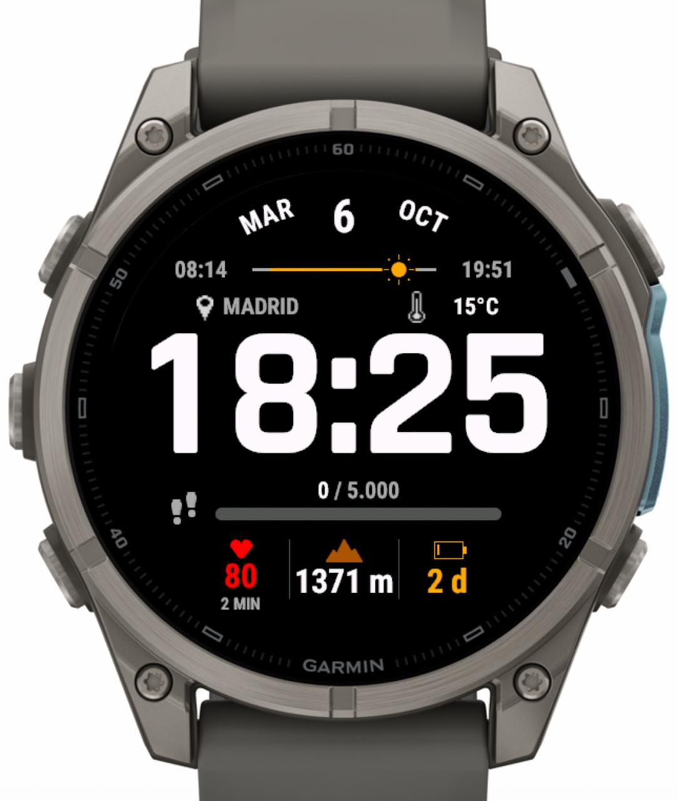

# Mountain Solar Watchface

Mountain Solar is a Garmin Connect IQ watch face written in Monkey C. It combines a large digital clock with weather, daylight progress, steps, heart rate, elevation, and battery information. The design started on the 47 mm fēnix 7 Solar. The manifest now declares 42 device profiles: nine visually verified profiles and 33 additional candidates selected from Garmin's device specifications.



[More screenshots](screenshots/screenshot2.jpeg) · [Quick start](#quick-start) · [Device profiles](#device-profiles) · [Privacy](#privacy-and-connectivity)

## Features and Current Status

- Large 24-hour clock and a date in the watch's language.
- Temperature in °C or °F and a cached city name for the weather observation's location.
- Sunrise/sunset bar with a sun during the day and a moon at night.
- Steps, daily goal, and an amber progress bar.
- Recent heart rate with sample age, elevation in meters or feet, and battery shown as days remaining or percentage.
- Altitude and temperature follow the watch's unit settings by default, with independent overrides on the watch or in Connect IQ settings.
- Resources for 36 watch languages, font fallbacks, and `--` for missing or expired data.

Simulator validation for unit settings passed 31 tests on each of the original nine profiles (279 total), including text-width checks with vector and native fallback fonts. Production `.prg` builds also passed for those nine profiles. The maintainer's visual review and the signed release `.iq` package built on 6 October 2026 cover the earlier version; the package used SDK 9.2.0 and included 15 device variants across those profiles. On 16 October 2026, device builds passed for all 42 declared profiles, including all 33 newly declared profiles. Simulator startup checks passed on nine representative profiles; visual review of the additions remains pending.

Memory and battery-life measurements on physical watches remain pending. AMOLED/MicroLED support is experimental: a dedicated always-on display (AOD) presentation is still pending. Time format is currently fixed at 24 hours.

## Quick Start

The documented development setup is **macOS with Connect IQ SDK 9.2.0**. The application's minimum Connect IQ API version is **5.2.0**.

### Prerequisites

1. Install Java for the SDK and make `java` available in your shell. The bundled SDK documentation requires Java 11 or later.
2. Install [Garmin's Connect IQ SDK Manager](https://developer.garmin.com/connect-iq/sdk/) and SDK 9.2.0. In **Devices**, download `fenix7` to follow this example, or another profile listed below.
3. Install Python 3 to use [tools/ciq.py](tools/ciq.py). It uses only the Python standard library.
4. Provide a local signing key. With Garmin's Monkey C extension for VS Code, use **Monkey C: Generate a Developer Key** if you do not already have one. Save it as `developer_key` in the project root, or pass its path with `--key`.

Keep the key private and backed up. `developer_key` is ignored by Git and is not included in a fresh checkout. Updates to an existing store application must use its original signing key.

Run the following commands from the project root.

### Build

```sh
python3 tools/ciq.py build fenix7
```

This creates `bin/devices/fenix7/mountain-fenix7.prg`. Build several profiles by listing them after `build`:

```sh
python3 tools/ciq.py build fenix7 fenix7s fenix7x
```

The helper discovers the active SDK through SDK Manager's macOS configuration. You can select the SDK and key explicitly:

```sh
python3 tools/ciq.py build fenix7 --sdk /path/to/sdk --key /path/to/local-key
```

It also accepts the `CIQ_SDK` environment variable. The helper is designed for the macOS setup; on other platforms, adapt the SDK tool invocation to your environment.

### Run in the Simulator

Open the simulator using the active SDK on macOS:

```sh
export CIQ_SDK="$(cat "$HOME/Library/Application Support/Garmin/ConnectIQ/current-sdk.cfg")"
"$CIQ_SDK/bin/connectiq"
```

Then, in another terminal at the project root:

```sh
python3 tools/ciq.py run fenix7
```

`run` rebuilds the selected profile before launching it. Stop the current app before switching profiles. VS Code's Monkey C extension is an alternative; its local launch configuration is not tracked in this repository.

### Install on a Physical Watch

Build for the watch's exact profile, connect it by USB, and copy the corresponding `bin/devices/<profile>/mountain-<profile>.prg` into `GARMIN/APPS`. Use an MTP client if your system requires one. Disconnect safely and select Mountain Solar on the watch.

A `.prg` is for a specific profile and local installation. A `.iq` packages the manifest's profiles for upload to Connect IQ.

## Device Profiles

The original nine profiles below are declared in [manifest.xml](manifest.xml) and visually verified by the maintainer. Display information comes from the installed SDK device definitions.

| Profile | Display | Resolution |
| --- | --- | --- |
| `fenix7` | MIP | 260 × 260 |
| `fenix7s` | MIP | 240 × 240 |
| `fenix7x` | MIP | 280 × 280 |
| `fenix7pro` | MIP | 260 × 260 |
| `fenix7spro` | MIP | 240 × 240 |
| `fenix7xpro` | MIP | 280 × 280 |
| `fenix8solar47mm` | MIP | 260 × 260 |
| `fenix8solar51mm` | MIP | 280 × 280 |
| `fenix947mm` | AMOLED, experimental | 454 × 454 |

Several profiles cover multiple commercial models: `fenix7` also covers quatix 7; `fenix7x` covers tactix 7, quatix 7X Solar and Enduro 2; `fenix8solar51mm` covers tactix 8 Solar 51 mm; and `fenix947mm` covers both 47 and 51 mm fēnix 9.

### Additional Declared Profiles

These 33 profiles are compatibility candidates based on Garmin's [device reference](https://developer.garmin.com/connect-iq/device-reference/), [API levels](https://developer.garmin.com/connect-iq/compatible-devices/) and [graphics capabilities](https://developer.garmin.com/connect-iq/api-docs/Toybox/Graphics.html#getVectorFont-instance_function), checked on 14 October 2026. They support API 5.2 or newer, round displays, the requested vector fonts, 128 KiB watch-face memory and 64 KiB background memory. All 33 profiles are installed and passed builds on 16 October 2026. Visual validation remains pending for the additions.

| Models | Profiles | Resolution |
| --- | --- | --- |
| fēnix 7 Pro / 7X Pro Solar, no Wi-Fi | `fenix7pronowifi`, `fenix7xpronowifi` | 260 / 280 square |
| fēnix 9 Pro Solar 47 / 51 mm | `fenix9prosolar47mm`, `fenix9prosolar51mm` | 260 / 280 square |
| Enduro 3 / 4 | `enduro3`, `enduro4` | 280 × 280 |
| Forerunner 955 / Solar | `fr955` | 260 × 260 |
| fēnix 8 AMOLED 43 mm | `fenix843mm` | 416 × 416 |
| fēnix 8 / tactix 8 / quatix 8 AMOLED 47 / 51 mm | `fenix847mm` | 454 × 454 |
| fēnix 8 Pro / MicroLED / quatix 8 Pro | `fenix8pro47mm` | 454 × 454 |
| fēnix 9 43 mm / 9 Pro 43 mm | `fenix943mm`, `fenix9pro43mm` | 416 × 416 |
| fēnix 9 Pro 47 mm | `fenix9pro47mm` | 454 × 454 |
| fēnix 9 Pro 51 mm | `fenix9pro51mm` | 466 × 466 |
| fēnix E | `fenixe` | 416 × 416 |
| epix Gen 2 / quatix 7 Sapphire | `epix2` | 416 × 416 |
| epix Pro Gen 2 42 mm | `epix2pro42mm` | 390 × 390 |
| epix Pro Gen 2 47 mm / quatix 7 Pro | `epix2pro47mm` | 416 × 416 |
| epix Pro Gen 2 51 mm / D2 Mach 1 Pro / tactix 7 AMOLED | `epix2pro51mm` | 454 × 454 |
| Forerunner 165 / 165 Music | `fr165`, `fr165m` | 390 × 390 |
| Forerunner 265 / 265S | `fr265`, `fr265s` | 416 / 360 square |
| Forerunner 965 | `fr965` | 454 × 454 |
| MARQ Gen 2, including Carbon variants / Aviator | `marq2`, `marq2aviator` | 390 × 390 |
| D2 Mach 1 | `d2mach1` | 416 × 416 |
| D2 Mach 2 / Mach 2 Pro | `d2mach2`, `d2mach2pro` | 454 × 454 |
| Approach S72 43 / 47 mm | `approachs7243mm`, `approachs7247mm` | 416 / 454 square |
| Venu 4 41 / 45 mm; D2 Air X15 uses the 45 mm profile | `venu441mm`, `venu445mm` | 390 / 454 square |

The first four rows are MIP; the remaining rows are AMOLED, with MicroLED also covered by `fenix8pro47mm`. Representative visual checks can focus on `fr265s` (360 px), `epix2pro42mm` (390 px), `epix2` (416 px) and `fenix9pro51mm` (466 px), supplementing the existing verified resolutions.

### Deferred Profiles

- Forerunner 70, 170 / Music, 570 and 970: the time would use Roboto Condensed instead of Bionic; visual review is pending.
- Venu 3 / 3S: the requested fonts are absent; native font fallbacks and straight date text need review.
- Venu X1: rectangular display layout needs review.
- vívoactive 6: the elevation-history API is unsupported; altitude behavior needs review.
- Approach S70 and Descent Mk3: Garmin lists API 5.1, below the manifest's minimum of 5.2.

Declaring a profile does not update the store listing or the existing release package. Install its device definitions through SDK Manager to compile it, export a new signed `.iq` including all declared profiles, then upload that package as an app update. Each profile needs to compile, but does not need a separate simulator session. An uninstalled profile can produce an `Invalid device id found in the application manifest` compiler warning even when its ID matches Garmin's catalog. On 16 October 2026, headless Java builds passed for all 42 declared profiles. Simulator startup checks confirmed app-start events and four seconds without a crash on `fr265s`, `epix2pro42mm`, `epix2`, `fenix9pro51mm`, `fr955`, `enduro3`, `venu445mm`, `approachs7243mm` and `approachs7247mm`; these checks do not certify visual layout, long-running behavior, physical-device performance or AOD support. Local build and simulator logs are under `bin/devices/<profile>/`; aggregate validation summaries are under `bin/profile-checks/`.

## Data Behavior

### Display Settings

Open Mountain Solar's settings on the watch or in the Connect IQ mobile app to choose display preferences:

| Setting | Choices | Default |
| --- | --- | --- |
| Altitude units | Use watch setting / Meters (m) / Feet (ft) | Use watch setting |
| Temperature units | Use watch setting / Celsius (°C) / Fahrenheit (°F) | Use watch setting |
| Battery display | Days remaining / Percentage (%) | Days remaining |

Automatic mode reads the watch's altitude and temperature preferences separately, so mixed units are supported. Changes to watch units appear on the next minute update or layout restoration; changes to the app's settings request an immediate update. Settings labels are translated for all 36 declared watch languages and shared by the on-watch menus and Connect IQ. Unit symbols (`m`, `ft`, `°C`, and `°F`) are preserved in every language.

Garmin supplies elevation in meters and weather temperature in Celsius. Those source values stay unchanged in the data snapshot; conversion and integer rounding happen only when formatting display text. For example, `1371 m` becomes `4498 ft` and `15°C` becomes `59°F`. Missing readings retain the selected unit (`-- m`, `-- ft`, `--°C`, or `--°F`). Longer values use a smaller font when needed; if native fallback fonts cannot fit altitude and unit together, the unit appears below the number.

To change these preferences directly on the watch, open the system's watch-face menu, select Mountain Solar and open its settings. The menu lists **Battery display**, **Temperature units** and **Altitude units**, with each saved choice shown below its label. Open a category to choose an option; the current choice is focused. Selecting an option saves it and returns to the settings list. Back leaves the choice unchanged; Back from the main settings list returns to the watch face. This works without a phone and uses the same saved preferences as Connect IQ. Menu names and the route to watch-face settings vary by watch model.

Battery display defaults to estimated days remaining, with `<1 d` for less than a day and a percentage fallback when the watch does not supply an estimate. Percentage mode always uses the charge percentage (for example, `50%`) and shows `--` if that reading is unavailable. Saving the setting updates the display immediately using cached readings; battery stats retain their five-minute refresh interval. The battery icon and its color continue to reflect the charge percentage in both modes. Battery menu labels are available at runtime for the on-watch menu and are translated in all 36 languages.

### Sources and Refresh

The watch face reads data already available through Garmin APIs. It does not start GPS or optical heart-rate sensing.

| Information | Source | Refresh policy |
| --- | --- | --- |
| Time, steps, and step goal | System time and ActivityMonitor | Once per minute |
| Date and localized labels | Gregorian calendar and language resources | On date or language changes; language checked each minute and when restoring the layout |
| Display units | System device settings and application properties | Watch preferences checked with the language; application properties cached until a settings change |
| Battery and estimated days | System stats | At startup, then every five minutes |
| Temperature and observation coordinates | Garmin Weather | At startup, then every five minutes; refreshed after a background city result |
| Heart rate and elevation | SensorHistory | At startup, then every five minutes |
| Sunrise and sunset | Garmin Weather solar calculations | Cached by date and rounded location; missing events retried every 15 minutes |
| City name | Local cache, then Nominatim for unknown locations | Background lookup only when needed |

Reading expiry is checked every minute. Weather observations older than two hours, heart-rate samples older than 15 minutes, and elevation samples older than 30 minutes are hidden. Missing permissions or data produce `--`; missing solar events produce `--:--`.

Weather coordinates may refer to a nearby station. The sun/moon position represents elapsed time within the daylight/nighttime interval; the moon does not indicate lunar phase. Solar labels use the watch's local time zone.

The watch language controls date abbreviations, short labels, and digit-group separators. City requests retain a Spanish language preference (`es`). Layout, fonts, and display text are cached between redraws; Garmin controls redraw cadence. See the [battery-efficiency specification](specs/battery-efficiency.md) for the detailed policy.

## Tests and Manual Checks

With the simulator open:

```sh
python3 tools/ciq.py test fenix7
```

This creates `bin/devices/fenix7/tests-fenix7.prg` and runs the test suite. The current suite contains 39 test functions covering solar intervals, city caching and retries, background scheduling, refresh intervals, layout/font fallbacks, locale changes, unit conversions and overrides, battery display preferences and fallbacks, on-watch menu navigation, persistence and cancellation, and settings changes with cached readings. List several profiles after `test` to run them sequentially.

The helper accepts `monkeydo` exit code 1 only when the final summary explicitly reports passing tests with no failures or errors. If a batch stalls while changing profiles, restart the simulator and test each profile separately.

For manual validation, check:

- Clipping, long city names and numbers, reached step goals, and spacing, especially on the 240 × 240 profiles.
- Language changes and readability, including accented, Cyrillic, Asian, and right-to-left text. Automated tests do not certify all 36 languages visually.
- Automatic and manual units, mixed units, negative temperatures/altitudes, and five-digit altitudes in feet. In the simulator, change device units or use the app settings editor to exercise overrides.
- Battery display changes between days remaining and percentage, including `100%`, `0%`, less than a day, and unavailable estimates/readings.
- The on-watch settings menu: with the watch face running in the simulator, use **Settings → Trigger App Settings**, open Battery display, Temperature units or Altitude units, and select an option. Confirm that the main settings list shows the new choice and the face updates after leaving settings. Check Celsius/Fahrenheit, meters/feet and automatic watch units independently. Reopen a category to check the saved choice, or press Back to cancel. This opens the local watch UI through `getSettingsView()`.
- Missing and expired readings, midnight, sunrise/sunset transitions, and return from low-power mode.
- Production memory usage and battery life on physical devices. Test drawing buffers do not represent production memory use.

In **Settings → Set Weather**, supply a recent observation with coordinates. Stop and rerun the watch face to read it immediately, or wait for its five-minute refresh. A new city also needs background execution and Internet connectivity; **Simulation → Background Events → Temporal Event** can trigger a pending lookup, subject to retry delays. Sensor-history fields require historical samples, which may not be created by changing an instantaneous sensor value.

The compiler currently warns about scaling the 48 × 48 launcher icon to 40 × 40 on MIP profiles and 65 × 65 on the AMOLED profile. These warnings do not prevent compilation.

## Export for Connect IQ

The manifest uses the public application's ID, `01f96394ed0545efbbff7daeb273c099`. The previously uploaded beta uses `b43f638859a94d1fa284624319725c88`. Connect IQ requires separate IDs for beta and public listings: upload the public package as a new app with **Beta App** unchecked. Keep the public ID for subsequent public updates. To update the beta, restore its ID for that export and then return the manifest to the public ID. Use the existing signing key for both.

Install all manifest device profiles, make Java available, and set `CIQ_SDK` to the SDK directory as shown in the simulator setup. Then create a signed release package:

```sh
RELEASE_VERSION=1.2.0 # Example: set this to the new release version.
mkdir -p bin/releases
"$CIQ_SDK/bin/monkeyc" -f monkey.jungle -e -r -w -l 1 \
  -o "bin/releases/mountainsolarwatchface-v${RELEASE_VERSION}.iq" -y developer_key
```

Use your actual key path after `-y` if it is stored elsewhere. `-e` packages all declared profiles and `-r` enables release mode. The output is `bin/releases/mountainsolarwatchface-v<version>.iq`. Use a new version filename for each release and preserve earlier packages. The local archive currently contains versions `1.0.0` and `1.1.0`; the unversioned package was an identical copy of `1.1.0` and was removed. Build artifacts and the release archive under `bin/` are ignored by Git: back up the release packages separately, because a fresh checkout will not restore them.

If the macOS export aborts while initializing Java's AWT application, the release export has also been verified with headless Java:

```sh
JAVA_TOOL_OPTIONS="${JAVA_TOOL_OPTIONS:+$JAVA_TOOL_OPTIONS }-Djava.awt.headless=true" \
  "$CIQ_SDK/bin/monkeyc" -f monkey.jungle -e -r -w -l 1 \
  -o "bin/releases/mountainsolarwatchface-v${RELEASE_VERSION}.iq" -y developer_key
```

Before public distribution, complete the outstanding device checks and the provider/privacy review described below. Generating a package does not publish the app.

## Privacy and Connectivity

An unknown weather location triggers an automatic background request to Nominatim/OpenStreetMap through Garmin Connect. It sends weather coordinates rounded to two decimal places, a Spanish language preference, and the application identifier. Rounding reduces precision but does not anonymize the location. Heart rate, elevation, steps, and battery are not sent to this service.

Up to eight recent locations and city names are stored on the watch, along with retry state. Saved cities work offline. Failed requests back off for 5, 15, 30, then 60 minutes. This version has no separate city-lookup switch or consent prompt.

Declared permissions are `SensorHistory`, `Positioning`, `Communications`, and `Background`. `Positioning` provides access to weather coordinates; the watch face does not request GPS acquisition.

Read the privacy policy in [English](PRIVACY.md) or [Spanish](PRIVACY.es.md). Before public distribution, publish an accessible policy URL and review consent and provider requirements. Public Nominatim usage and the ability to change providers remain items for release review.

City data © [OpenStreetMap contributors](https://www.openstreetmap.org/copyright), under the ODbL license, through [Nominatim](https://nominatim.org/). Its [usage policy](https://operations.osmfoundation.org/policies/nominatim/) applies.

## Project Structure

| Path | Purpose |
| --- | --- |
| [manifest.xml](manifest.xml), [monkey.jungle](monkey.jungle) | Device profiles, permissions, source paths, and localized resource mappings |
| [source/](source/) | Application and view, data provider, solar bar, city service, layout, fonts, and presentation caches |
| [resources/](resources/) | Icons, localized strings, and display settings; the font directory is a placeholder |
| [tests/](tests/) | Simulator unit tests and their Jungle configuration |
| [tools/](tools/) | Build/run/test helper and status-icon generation utility |
| [specs/](specs/) | Original design brief and battery-efficiency requirements |
| [screenshots/](screenshots/) | Visual references |
| `bin/releases/` | Versioned signed `.iq` packages retained as a local release archive |
| `bin/devices/<profile>/` | Profile-specific PRGs, test binaries, settings, debug symbols, and validation logs |
| `bin/profile-checks/` | Aggregate build and simulator validation summaries |
| `bin/gen/` | Generated sources referenced by existing debug symbols; compiler caches and MIR intermediates can be regenerated |

The [original watchface specification](specs/watchface-specification.md) records the initial single-device MVP brief. Some requirements have since changed, including device coverage and external city lookup; use this README and the implementation for current behavior. The [battery-efficiency specification](specs/battery-efficiency.md) documents refresh and caching decisions.

## Remaining Work

- Measure production memory and battery life on physical watches.
- Implement and validate AMOLED AOD, transitions, and luminance behavior.
- Review visual readability across all declared languages.
- Add configurable time format.
- Review public city-service usage, privacy requirements, and release assets before publication.
